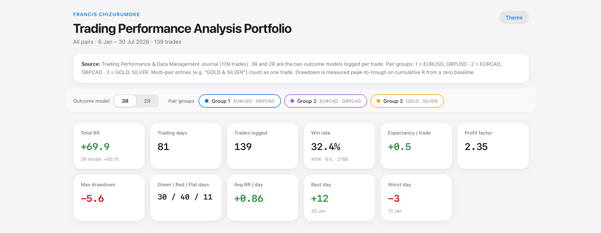
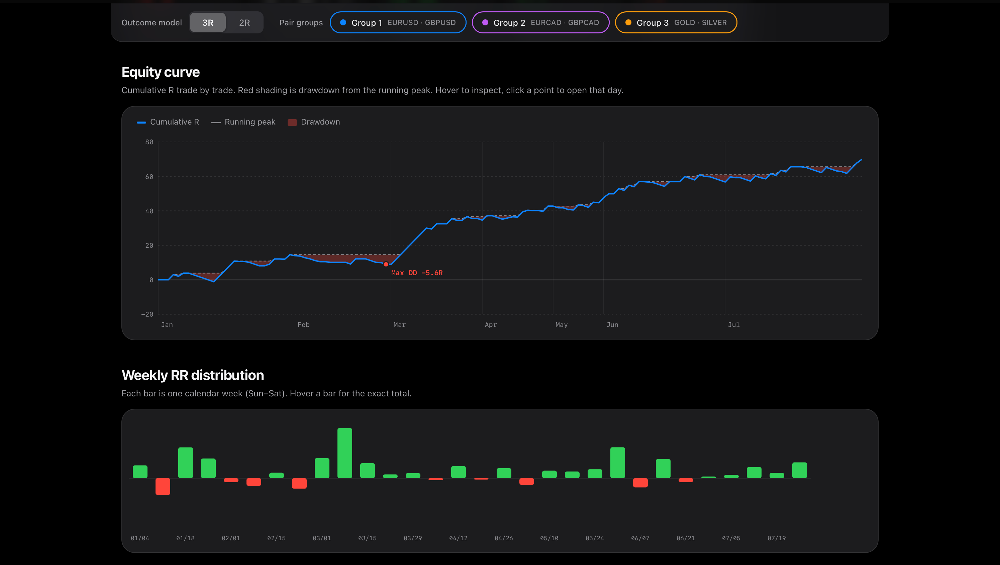

# Trading Performance Analysis Portfolio — Interactive R-Multiple Dashboard

An interactive trading performance dashboard I built from my own manually maintained trading journal. It turns recorded trade results into an R-multiple calendar, equity curve, weekly performance distribution and detailed trade breakdown.

**Live dashboard:** [Open the Trading Performance Analysis Portfolio](https://francisos1234.github.io/trading-performance-journal/)

**GitHub repository:** [Francisos1234/Trading-performance-journal](https://github.com/Francisos1234/Trading-performance-journal)

Built by **Francis Chizurumoke**, with AI-assisted coding using ChatGPT and Claude.

---

## Project overview

This project brings together three parts of my trading performance workflow:

1. **Manual data collection:** I record my trades in a Notion trading journal, including their results in R-multiples.
2. **Data preparation and analysis:** I export the journal to CSV, then clean, organise, analyse and validate the data in Microsoft Excel.
3. **Interactive visualisation:** I use the prepared dataset in a standalone HTML dashboard so I can explore the performance across time, outcome models and instrument groups.

The dashboard covers **139 logged trades from 6 January to 30 July 2026**. It includes two outcome models, **3R and 2R**, and lets users filter the results by three instrument groups:

- **Group 1:** EURUSD and GBPUSD.
- **Group 2:** EURCAD and GBPCAD.
- **Group 3:** GOLD and SILVER.

The dashboard displays headline performance metrics, cumulative R, drawdown, weekly results, monthly calendars and a day-by-day trade breakdown. It also includes light and dark themes.

The purpose is to make the journal data easier to inspect and compare, rather than leaving the information inside a table of individual trade records.

## The problem I wanted to solve

Recording trades is important, but a journal containing individual entries does not always make it easy to understand performance as a whole.

I wanted to be able to answer questions such as:

- How much R did I gain or lose over the period?
- What did the equity curve look like trade by trade?
- How deep was the maximum drawdown?
- Which months and weeks contributed most to the result?
- How did the 3R outcome model compare with the 2R model?
- Which instrument group performed better or worse?
- What happened on a particular trading day, and which trades contributed to that day's result?

I also wanted the numbers in the dashboard to be traceable to the journal and analysis workbook.

That meant the project was not just about building a nice-looking dashboard. A major part of the work was collecting the trade data consistently, preparing it properly and checking that the figures reconciled before visualising them.

## Your contribution

This is my own trading performance project. I personally carried out the manual data collection and designed the process used to prepare, analyse and present the results.

My contribution included:

- Recording individual trades manually in Notion.
- Maintaining the trade results in R-multiples.
- Organising the journal so that the trade records could be exported and analysed.
- Exporting the journal data to CSV.
- Cleaning and structuring the exported data in Microsoft Excel.
- Building the analysis and summary tables used to review the results.
- Creating validation checks to compare the prepared data against the original journal.
- Defining the performance metrics and the three instrument groups.
- Preparing the dataset used by the dashboard.
- Specifying the dashboard views and how the 3R and 2R outcome models should be compared.
- Reviewing the dashboard against the prepared figures and checking the displayed results.

I used ChatGPT and Claude as coding assistants when developing the dashboard. They helped with implementation, but the trading records, data preparation workflow, analysis requirements, validation approach and project direction came from me.

## Tools and technology

| Tool | How I used it |
| --- | --- |
| Notion | Manually recording and maintaining my trading journal, including R-multiple outcomes |
| CSV export | Moving the journal records from Notion into a format that could be cleaned and analysed |
| Microsoft Excel | Cleaning, organising, summarising and analysing the exported trade data; building the Method & QA checks |
| Google Sheets | Providing a browser-accessible, view-only version of the spreadsheet analysis for review |
| HTML, CSS and JavaScript | Building the interactive dashboard as a self-contained web page |
| ChatGPT and Claude | AI-assisted coding and development support |
| GitHub | Version control, project documentation, screenshots and hosting the project source |
| Browser testing | Reviewing the live dashboard, filters, charts, calendar and trade detail views |

**A note on the spreadsheet workflow:** Microsoft Excel was used for the data cleaning, analysis and validation work. The Google Sheets link is provided as a view-only way to access the workbook online. I am not presenting the dashboard as a live integration with Notion, Excel or Google Sheets.

## Methodology

I separated the work into data collection, data preparation, validation, analysis and visualisation.

### 1. Manually collect the trading data in Notion

I record my trades manually in a Notion journal. The journal is the source of the trade records used in this project.

The results are recorded in R-multiples rather than being presented as cash profit or account percentage returns. This makes it possible to compare trade outcomes using a common risk-based unit.

The journal covers the trade date, instrument or pair, trade details and the recorded outcomes used in the analysis.

### 2. Export the journal to CSV

Once the records are in the journal, I export the data to CSV.

This creates a separate dataset that I can work with in Excel. It also gives me a clear separation between the original journal entries and the cleaned data prepared for analysis.

### 3. Clean and organise the data in Microsoft Excel

I use Microsoft Excel to clean and structure the exported records before calculating the performance summaries.

This preparation is important because the dashboard depends on consistent trade dates, trade counts, R-multiple values and instrument group assignments.

I also organise the data so that the two outcome models can be analysed side by side:

- **3R model:** the first recorded outcome model for each trade.
- **2R model:** the alternative outcome model recorded for the same trade.

These are the two outcome datasets shown in the dashboard. They allow the same set of 139 logged trades to be compared under the two recorded result models.

### 4. Validate the prepared data

I created a **Method & QA** sheet in the Excel workbook to check the prepared dataset before using it in the dashboard.

The checks include:

- **Trade count:** checking that the number of prepared records matches the journal.
- **Sequence continuity:** checking that the trade sequence is complete and consistent.
- **Reconciliation to journal totals:** comparing the calculated results with the totals in the source journal.
- **Group totals:** checking that the instrument group summaries reconcile with the overall dataset.
- **Drawdown:** checking the drawdown calculation against the cumulative R sequence.

These checks help catch issues such as missing records, inconsistent sequence numbers or totals that do not reconcile.

The workbook is part of the evidence for the process, not just a source of headline numbers.

### 5. Analyse the performance

After preparing and checking the data, I calculate the performance summaries for both outcome models.

The analysis includes:

- Total R gained.
- Number of completed trades.
- Wins, losses and break-even trades.
- Win rate.
- Average winning and losing result in R.
- Expectancy per trade.
- Profit factor.
- Maximum drawdown in R.
- Performance by instrument group.
- Monthly performance.
- Daily and weekly results.

The instrument groups are:

| Group | Instruments |
| --- | --- |
| Group 1 | EURUSD, GBPUSD |
| Group 2 | EURCAD, GBPCAD |
| Group 3 | GOLD, SILVER |

If a journal entry combines more than one instrument, such as GOLD and SILVER, it is counted as one trade in the dataset, as shown in the dashboard's source note.

### 6. Build the interactive dashboard

Once the data has been prepared and checked, I use it to build the dashboard.

The dashboard is a single, self-contained HTML file. It visualises the prepared dataset and recalculates the displayed summaries when the user changes the outcome model or instrument group filters.

The main dashboard features are:

- **Headline metrics:** total R, trading days, trades logged, win rate, expectancy per trade, profit factor and maximum drawdown.
- **Equity curve:** cumulative R trade by trade, with the running peak and drawdown shown visually.
- **Weekly R distribution:** a bar chart showing the total R for each calendar week.
- **Monthly performance calendar:** daily R results, number of trades and weekly totals for each month.
- **Daily trade breakdown:** select a trading day to inspect the individual trades, instruments, direction, order type and results under both models.
- **Outcome model toggle:** switch between the 3R and 2R results.
- **Instrument group filters:** view all instruments or filter to one or more of the three groups.
- **Light and dark themes:** change the dashboard appearance.

The dashboard is a visualisation of the prepared data. It does not automatically pull new trades from Notion or update itself when the Excel workbook changes. The dataset must be prepared and the dashboard data updated as a separate step.

## Results from the recorded dataset

The dashboard currently contains 139 trades recorded between **6 January and 30 July 2026**.

The following figures are the overall results displayed by the dashboard with all three instrument groups selected.

| Metric | 3R model | 2R model |
| --- | ---: | ---: |
| Trades logged | 139 | 139 |
| Total R | +69.90R | +50.75R |
| Win rate | 32.4% | 38.8% |
| Expectancy per trade | +0.503R | +0.365R |
| Maximum drawdown | -5.60R | -5.00R |

These figures are included to show what the dashboard reports for this particular dataset. They are not a claim that either model will produce the same results in future trading.

The two models produce different outcomes because each trade has a result recorded under both the 3R and 2R systems. The dashboard lets the user compare those results using the same trade records and filters.

## Validation

I did not want to rely only on the dashboard looking correct. I also wanted to check that the data behind it was consistent with the original journal.

My validation process includes:

1. Comparing the number of trade records with the source Notion journal.
2. Checking sequence continuity to identify missing or inconsistent trade numbers.
3. Reconciling the calculated totals with the journal's totals.
4. Checking that the instrument group totals add up to the overall figures.
5. Reviewing the cumulative R sequence and drawdown calculation.
6. Comparing the Excel summaries with the figures displayed in the dashboard.
7. Changing the dashboard filters and outcome model to check that the displayed results respond to the selected data.

The Method & QA sheet documents the spreadsheet checks. I also reviewed the dashboard views against the prepared dataset.

These are checks I performed as part of my own workflow. They improve traceability and help identify data-preparation errors, but they are not an independent audit of the trading records or a guarantee that every manual entry is free from error.

## Limitations

There are some important boundaries to what this project establishes.

1. **The results come from a personal trading journal.** They are not audited brokerage statements or independently verified broker execution records.
2. **R-multiples are not cash returns.** The dashboard reports trading outcomes in R. It does not establish the actual monetary profit or loss in a live account.
3. **The dataset covers a specific period.** The 139 trades shown cover 6 January to 30 July 2026. They should not be treated as a complete picture of every possible market condition or future performance.
4. **The 3R and 2R models are recorded outcome models.** They are compared using the same logged trades. The comparison does not prove that either model will perform the same way on future trades.
5. **Data quality depends partly on manual recording.** The validation checks can identify inconsistencies, but they cannot independently confirm every trade detail against a broker statement.
6. **The dashboard is not a live journal integration.** It visualises a prepared dataset. New journal records require a separate export, preparation, validation and dashboard update process.
7. **The analysis is descriptive, not predictive.** Historical expectancy, win rate and drawdown do not guarantee future results.
8. **This is not financial advice.** The project is intended to document and analyse a trading dataset, not recommend trades or promise returns.

## Evidence and project links

The repository includes the dashboard, the screenshots of its main views, and images showing the Notion journal and Excel analysis workbook.

- **[Open the live dashboard](https://francisos1234.github.io/trading-performance-journal/)**
- **[View the GitHub repository](https://github.com/Francisos1234/Trading-performance-journal)**
- **[Open the Notion trading journal](https://keen-aphid-255.notion.site/1d6b72eefb448311bc0881252fd9eff1?v=351b72eefb448242bc4708990c24df04)**
- **[View the Excel analysis workbook online (Google Sheets)](https://docs.google.com/spreadsheets/d/1Zb0AqxhuoKOI4FfsY-HOJ8ML6g8eN37X/edit?usp=sharing)**

### Dashboard screenshots

#### 1. Dashboard overview

The main dashboard view showing the selected outcome model, instrument group filters and headline performance metrics.

#### 2. Equity curve and weekly R distribution

The equity curve displays cumulative R trade by trade, the running peak and the drawdown from that peak. The weekly chart shows the R total for each calendar week.

| Light theme | Dark theme |
| --- | --- |
|  |  |

#### 3. Monthly performance calendar

The calendar displays daily R totals and trade counts, with weekly totals alongside each month.

| Light theme | Dark theme |
| --- | --- |
|  |  |

#### 4. Daily trade breakdown

Selecting a day opens a detailed view of the trades recorded for that date, including the instrument, direction, order type and both the 3R and 2R outcomes.

### Data collection and analysis screenshots

#### 5. Notion trading journal

The source journal where I manually record the trades and their R-multiple outcomes.

#### 6. Excel analysis workbook

The workbook used to clean, summarise, analyse and validate the exported journal data. The Method & QA sheet includes checks for trade count, sequence continuity, reconciliation, group totals and drawdown.

| Workbook overview | Performance detail |
| --- | --- |
|  |  |

## Related portfolio pieces

These projects and resources show different parts of my work around trading, data collection, performance analysis and risk management.

- **[Notion Trading Journal](https://keen-aphid-255.notion.site/1d6b72eefb448311bc0881252fd9eff1?v=351b72eefb448242bc4708990c24df04)** — the journal I use to manually record trades and their R-multiple results.
- **[Excel Analysis Workbook](https://docs.google.com/spreadsheets/d/1Zb0AqxhuoKOI4FfsY-HOJ8ML6g8eN37X/edit?usp=sharing)** — the workbook used to clean, analyse, summarise and validate the exported journal data. A view-only online copy is available through Google Sheets.
- **[Trading Equity Curve Simulator — Monte Carlo](https://github.com/Francisos1234/Monte-Carlo-Simulator)** — uses trading statistics as inputs to explore different hypothetical equity-curve outcomes across multiple simulations.
- **[Prop Firm Challenge Calculator](https://github.com/Francisos1234/Prop-Firm-Challenge-Calculator)** — explores challenge structures, drawdown limits, risk settings and estimated challenge outcomes.
- **[TradeDesk — Free Trading Journal](https://github.com/Francisos1234/Trade-desk-Free-Trading-Journal)** — a browser-based journal for recording trades and reviewing trading activity.

## Copyright and disclaimer

© 2026 Francis Chizurumoke. All rights reserved. This repository is public for viewing and evaluation only. See [LICENSE](LICENSE).

The results shown are R-multiples taken from a personal trading journal. They are not audited brokerage statements, realised account returns or a forecast of future performance. Nothing in this project is financial advice.
