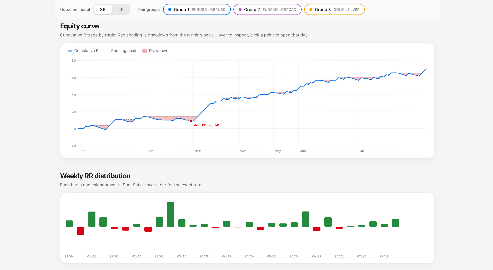
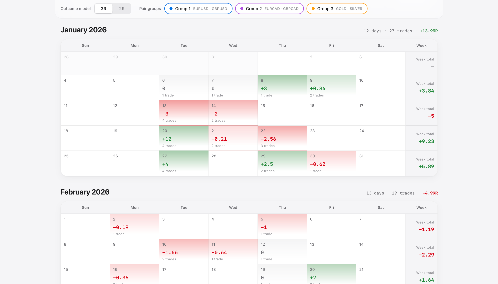
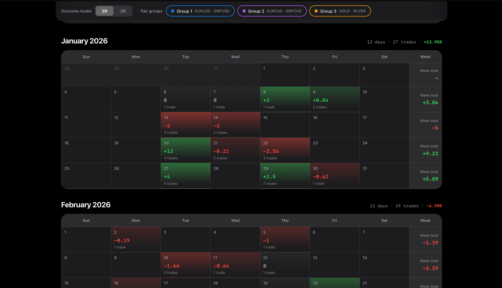
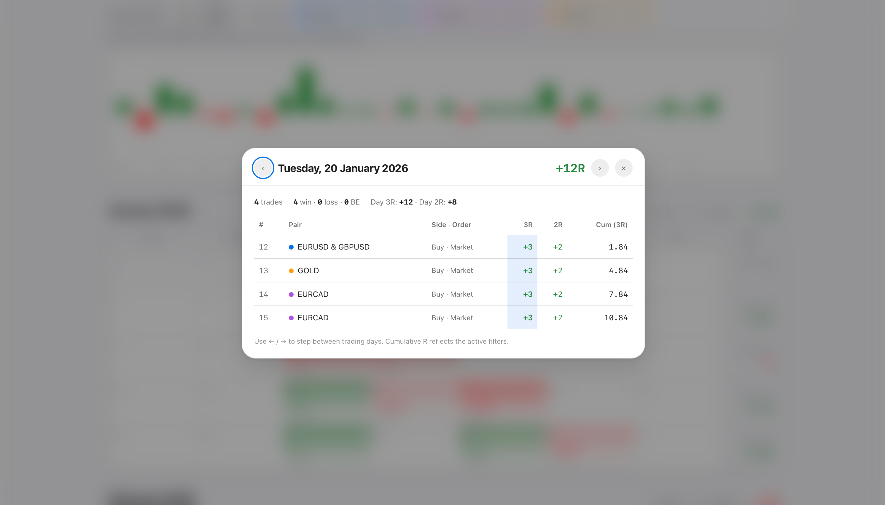

# Trading Performance Analysis Portfolio — Interactive RR Calendar

An interactive, single-file HTML dashboard that turns a trading journal into an R-multiple calendar, equity curve and weekly distribution, with a toggle between two outcome models (3R and 2R).

**Live demo:** https://francisos1234.github.io/trading-performance-journal/

> Built by **Francis Chizurumoke** with AI-assisted coding (ChatGPT and Claude). My contribution: data collection, workflow design, data preparation and validation, and specifying the metrics.

## What it shows

- Headline stats: total R, expectancy per trade, win rate, maximum drawdown
- Equity curve (cumulative R) with drawdown
- Weekly R distribution and monthly calendars with daily totals
- Switch between the **3R** and **2R** outcome models, and filter by pair group
- Day-by-day detail view
- Light and dark themes

## Screenshots

The screenshots below show the dashboard's main views. Select any image to open it at full size.

### Dashboard overview

### Equity curve and weekly R distribution

| Light theme | Dark theme |
| --- | --- |
|  |  |

### Monthly performance calendar

| Light theme | Dark theme |
| --- | --- |
|  |  |

### Daily trade breakdown

## How the data was prepared

The dashboard is based on a trading journal and a separate analysis workbook. The screenshots below show the source journal and the Excel analysis used to prepare and validate the data.

### Notion trading journal

Trades are logged manually in a Notion journal using R-multiples.

### Excel analysis and validation

The journal is exported to CSV, then cleaned and summarised in Excel. The workbook includes a Method & QA sheet with validation checks covering trade count, sequence continuity, reconciliation to the journal's totals, group totals and drawdown.

| Workbook overview | Performance detail |
| --- | --- |
|  |  |

The dashboard visualises the prepared dataset.

## Notes

- Single self-contained file: no external requests, no cookies, no tracking.
- Results are R-multiples taken from a trading journal. They are **not** audited brokerage statements, realised account returns, or a forecast of future performance. Nothing here is financial advice.

## Related portfolio pieces

- Notion journal: https://keen-aphid-255.notion.site/1d6b72eefb448311bc0881252fd9eff1?v=351b72eefb448242bc4708990c24df04
- Excel analysis (Google Sheet, view only): https://docs.google.com/spreadsheets/d/1Zb0AqxhuoKOI4FfsY-HOJ8ML6g8eN37X/edit?usp=sharing
- Trading Equity Curve Simulator (Monte Carlo): https://script.google.com/macros/s/AKfycbzR7RuM7IsYdzRFrOE_peBkDIjyL7Cr9Y_QYdZ8s69bHIu-R3LzBOcDfGvGGGIQ-LY7/exec
- Prop Firm Challenge Calculator: https://script.google.com/macros/s/AKfycbwnaxx80HH8lQtKq4RHcDCzDiXhXzvbLEqvZcLG7QeLJSCT9v-QReTIKrf6S_MtXKG1KA/exec

## Copyright

© 2026 Francis Chizurumoke. All rights reserved. This repository is public for viewing and evaluation only. See [LICENSE](LICENSE).
